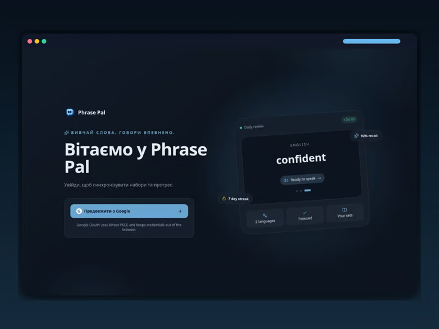

# Phrase Pal

**Live demo:** [phrase-pal-olive.vercel.app](https://phrase-pal-olive.vercel.app)



Phrase Pal is a Next.js app for learning words and phrases with spaced review, synced sets and progress via Nhost with Google sign-in.

## Stack

- Next.js 16 (App Router), React 19, TypeScript
- Tailwind CSS v4, tw-animate-css, Lucide icons
- Nhost (Postgres + Hasura GraphQL, Auth) with Google OAuth via PKCE
- React Hook Form + Zod for form validation
- ESLint + Prettier

## Local development

```bash
pnpm install
pnpm dev
```

See [NHOST_SETUP.md](NHOST_SETUP.md) for backend and OAuth setup.

## Text sets

Create a Text set, then paste English paragraphs through **Import text**. A blank line separates paragraphs; the preview lets you edit each detected sentence and add optional Ukrainian translations. The reading page supports sentence playback, text selection, and sentence or paragraph flashcards. Phrase saving uses an existing vocabulary set.

Apply the Nhost migration and metadata in `nhost/migrations/default/202610130001_text_sets` before using Text sets against a backend. Automatic translation is not configured; full-sentence translations can be entered at import, and selected fragments can be translated manually before saving.

Run `pnpm test:text` for import and text-model regression tests.
